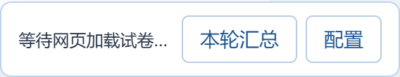
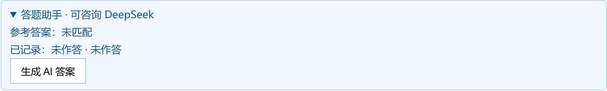
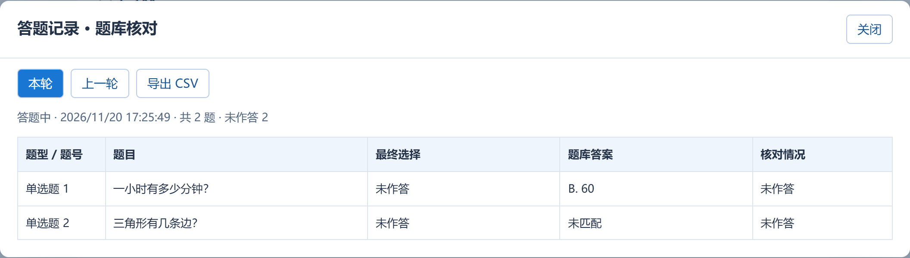

# 金工实习答题助手

适用于中南大学金工实习系统的报告答题页（地址含 `/zndxstudent/#/report-exame`）。脚本按选项内容匹配题库，记录每题最终选择，支持手动调用 DeepSeek 和导出 CSV。下图均截自本地测试环境。

## 1. 安装脚本

1. 在 Edge 或 Chrome 中安装并启用 Tampermonkey（篡改猴）。
2. 打开 [最新 Release](https://github.com/threebod/csu-report-helper/releases/latest)，在 **Assets** 中点击 **report-helper.user.js**。如果出现 Tampermonkey 安装页，点击“安装”；如果浏览器下载了文件，用文本编辑器打开，复制全文，在 Tampermonkey 管理面板中新建脚本、粘贴并保存。
3. 确认脚本处于启用状态，扩展有权访问 `szgxjx.csu.edu.cn`。在开始答题前安装，打开报告答题页后，右下角应出现 **本轮汇总** 和 **配置**。登录页没有这两个按钮。

公开版附带原创示例题。要使用自己的 PDF 题库，请参见第 4 节。

## 2. 在答题页配置 DeepSeek



1. 在 [DeepSeek 开放平台](https://platform.deepseek.com/) 创建 API Key，并确认账户有可用额度。
2. 回到报告答题页，点击上图右侧的 **配置**。在弹出的输入框中粘贴 Key，点“确定”保存。油猴菜单中的 **设置 DeepSeek API Key** 也能打开同一个输入框。
3. 更换密钥时重新输入并确定。要清除密钥，留空并点“确定”。点“取消”会保留已有设置。

Key 存在当前浏览器的油猴脚本存储中。配置截图、问题反馈和公开仓库中请勿包含真实密钥。

## 3. 核对题库与生成 AI 答案

题库唯一匹配时，进入尚未作答的题目会自动勾选。即使网页调整了选项顺序，脚本也会按内容对应。你可以手动改选，汇总保留最后一次选择。



遇到“未匹配”或“匹配不确定”，点击题干下的 **生成 AI 答案** 才会发送当前题型、题干和选项。请求按 DeepSeek 账户的费率计费。若答案返回时仍停留在该题且尚未选择，助手会勾选返回的选项。最终由你核对并提交报告。

## 4. 使用自己的 PDF 题库（可选）

下载仓库源码并解压，在已有 Python 和 PyMuPDF 的环境中，从含有 `build.py` 的目录运行：

```sh
python build.py "你的题库.pdf"
```

解析器要求 PDF 能提取文字，题目采用“题干 → A.、B. 等逐行选项 → 答案：字母”的排列，多选答案形如 `答案：AC`。生成文件为 **personal.user.js**。用它的完整内容替换油猴中原脚本并保存。若构建提示某页选项异常，请先核对那一页的文本顺序和答案标记。

## 5. 查看和导出答题记录



点击右下角 **本轮汇总**，选择 **本轮** 或 **上一轮**，再点 **导出 CSV**。答题过程中也能导出。文件可用 Excel 打开，包含题型、题号、题干、选项、最终选择、题库答案和核对结果。

切题、改选和刷新会延续当前记录。网站确认提交成功后，本轮标记为“已成功提交”。如果网站先更换了作答记录 ID，助手会保留旧轮为“提交状态未确认”，并记录新一轮。每份报告保留本轮和上一轮，更早的记录可提前导出留存。

导出文件名使用项目名及网站公布的成绩，例如 `铸造报告_90分_答题记录_本轮_….csv`。没有对应数据时会显示“未知项目”或“成绩未公布”。

## 常见问题

- **页面里找不到“配置”**：确认已进入报告答题页，检查油猴脚本是否启用，并确认使用的是带有页面配置按钮的版本（1.1.2 或更新）。
- **AI 请求返回 HTTP 401**：重新打开“配置”，核对密钥是否完整、是否已被撤销。HTTP 402 时请检查 DeepSeek 账户余额。
- **更新后只有示例题**：Release 分发的是公开版。使用自有题库时，请从新版源码重新运行构建命令，再安装生成的个人版。

源码采用 [MIT 许可证](LICENSE)。
